<p align="center">
  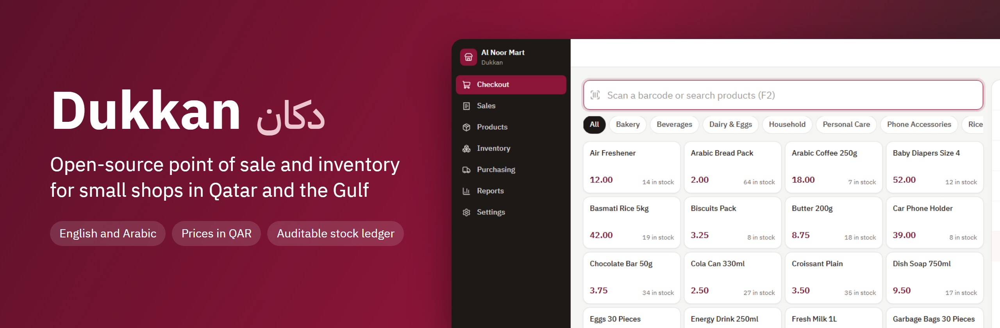
</p>

Dukkan (دكان, Arabic for a small shop) is an open-source point of sale and inventory system for small shops in Qatar and the Gulf, such as groceries, pharmacies and phone shops. It has a full Arabic interface and prices in QAR.

[](LICENSE)


Many small shops still keep stock in a notebook or a spreadsheet, or pay for point of sale software built for much bigger chains, so the owner finds out an item ran out when a customer asks for it. A shop in Doha often has an Arabic speaking owner, English speaking staff and customers who read either, so each user picks a language, the whole interface mirrors to right to left, and every product, category and branch has an Arabic name. Every change to stock is a row in a ledger, so the number on the screen can always be explained line by line.

| | |
| --- | --- |
| 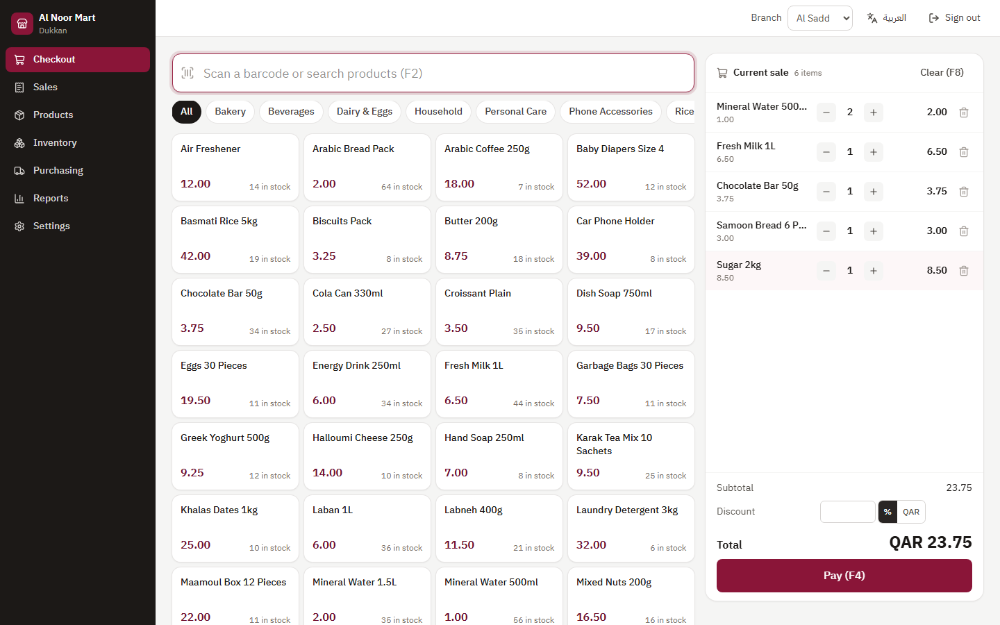 | 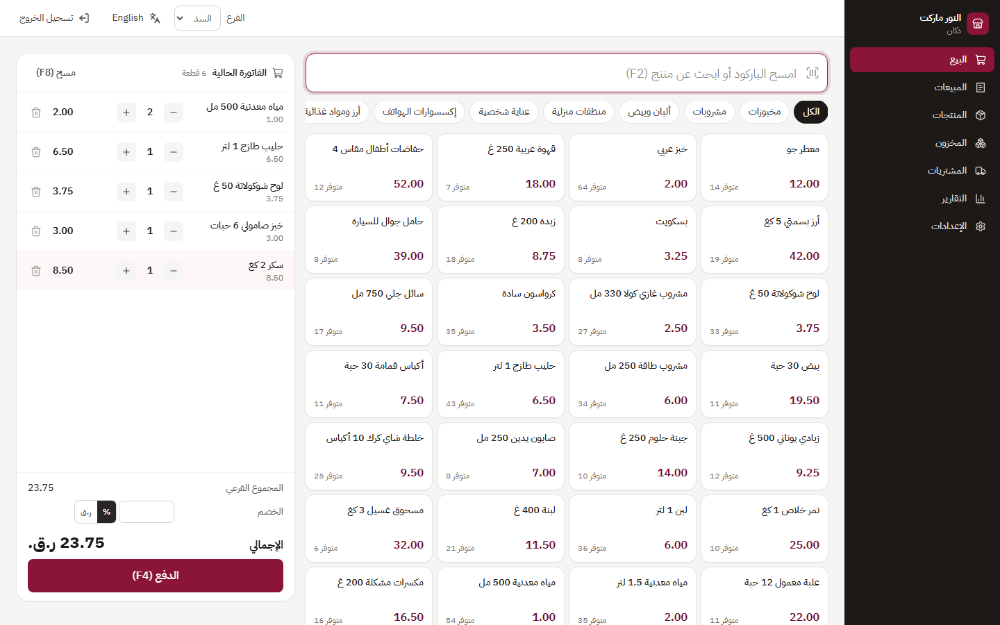 |
| Checkout: scan, search or tap to build a sale. | The same screen in Arabic, mirrored right to left. |
| 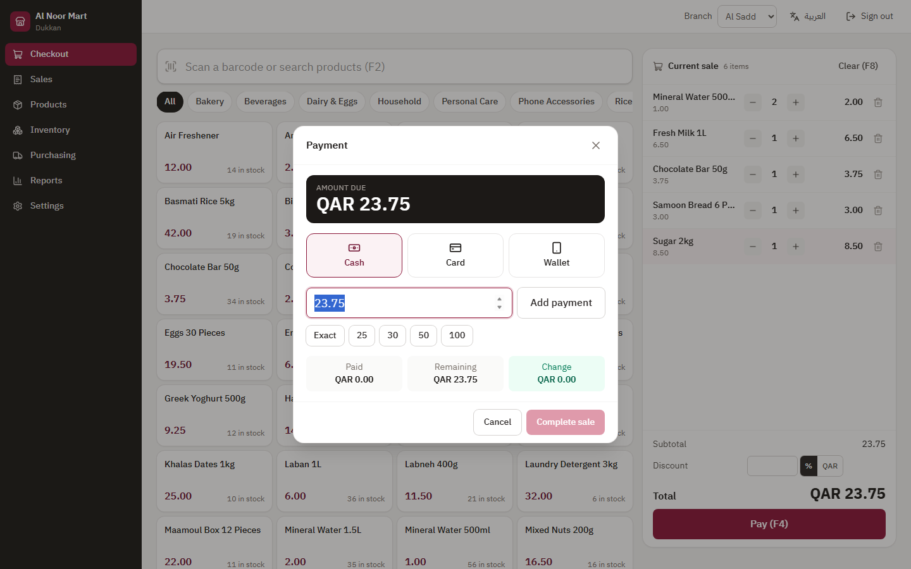 | 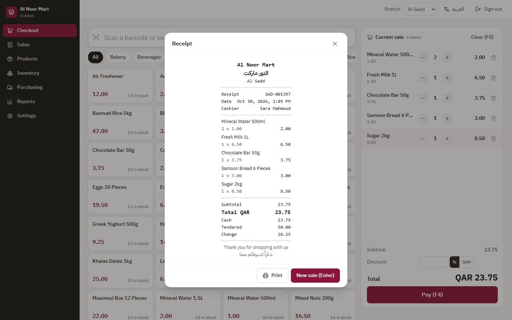 |
| Split payment between cash, card and wallet, with change worked out. | Receipt with shop details in both languages. |
| 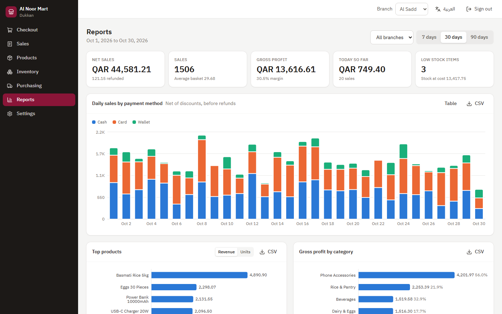 | 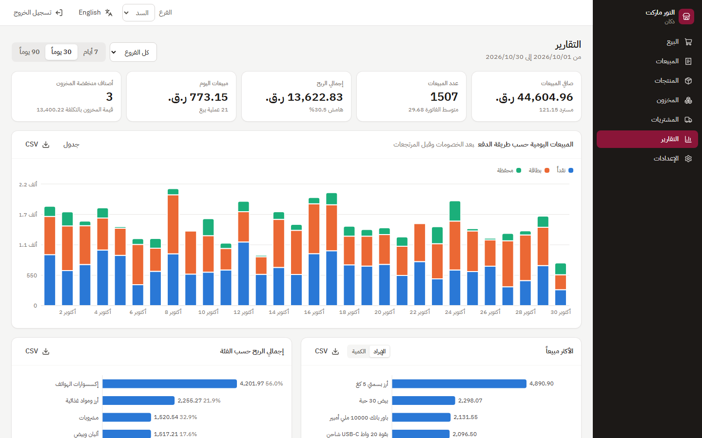 |
| Sales, profit, payment mix and CSV export. | Reports in Arabic. |
| 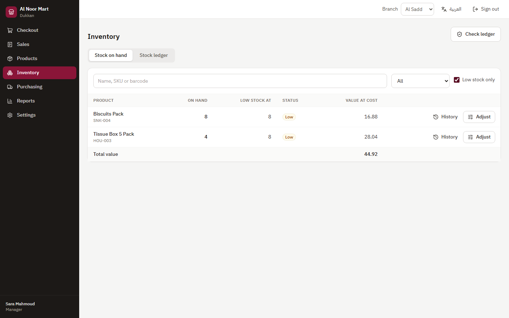 | 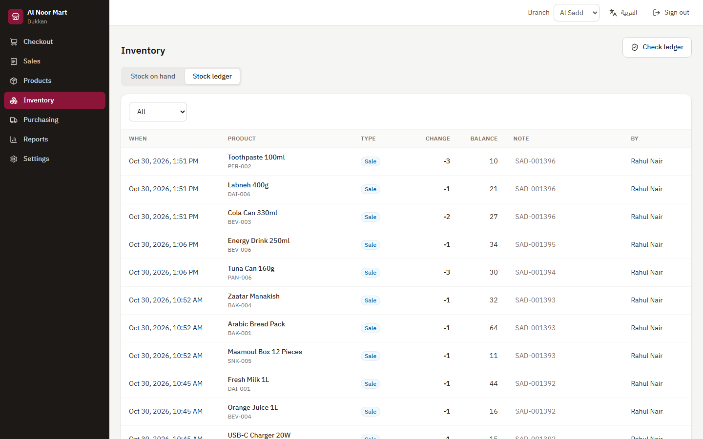 |
| Low stock at a glance, per branch. | The stock ledger: every change, who made it and the balance after. |
| 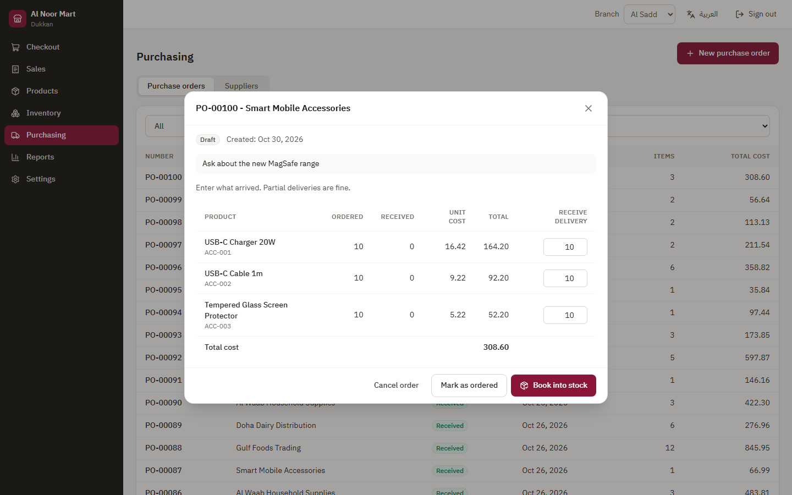 | 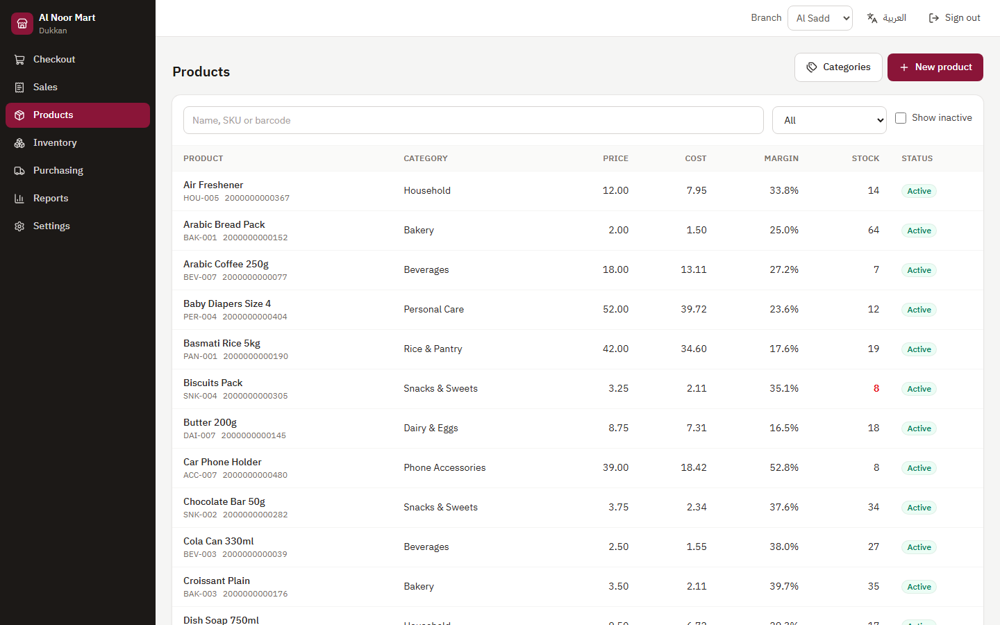 |
| Receiving a delivery in full or in parts. | Products with prices, margin and stock per branch. |

These are captures of the running app with the demo shop loaded.

## Getting started

You need [Python 3.12](https://www.python.org/downloads/), [Node.js 22 or newer](https://nodejs.org/) and Git. The commands are for PowerShell on Windows, and the [Windows run guide](docs/running-on-windows.md) has more detail and fixes for common problems.

Start the API in one terminal:

```powershell
git clone https://github.com/Ifazawezk/dukkan.git
cd dukkan\backend
python -m venv .venv
.venv\Scripts\Activate.ps1
pip install -r requirements-dev.txt
copy .env.example .env
alembic upgrade head
python -m app.cli seed
uvicorn app.main:app --reload
```

Then the web app in a second terminal:

```powershell
cd dukkan\frontend
npm install
npm run dev
```

Open http://localhost:5173 and sign in. Every demo account uses the password `dukkan123`.

| Username | Role | Lands on |
| --- | --- | --- |
| `owner` | Owner, everything including settings and staff | Reports |
| `manager` | Manager, Al Sadd branch | Reports |
| `rahul`, `maria` | Cashiers, Al Sadd branch | Checkout |
| `omar` | Cashier, Al Wakra branch | Checkout |

The seed command builds 45 days of history backwards from today, so the reports always have recent data. The random seed is fixed, so two runs at the same moment give the same shop.

### Docker

```bash
docker compose up --build
docker compose exec api python -m app.cli seed
```

This runs the web app, the API and PostgreSQL at http://localhost:8080. Set `POSTGRES_PASSWORD` and `DUKKAN_SECRET_KEY` before using it for anything real, as the notes at the top of [docker-compose.yml](docker-compose.yml) explain. The Docker files have not been run yet, because the machine this was built on has no Docker. The PostgreSQL setup they use was tested separately (see [Performance and tests](#performance-and-tests)).

## What it does

At the till:

- Keyboard and barcode friendly: F2 search, F4 pay, F8 clear, Enter to add a scanned code
- Arabic search ignores how the hamza, a final ة or a final ى was typed, so ارز finds أرز and قهوه finds قهوة
- Order discounts by percent or amount, with a limit for cashiers set by the owner
- Split payments across cash, card and wallet, with change given from cash only
- Printable receipts in the browser, plus a plain text version for 80 mm printers
- Returns and refunds at the discounted price actually paid, with damaged goods kept out of stock
- A sale that would take stock below zero is refused with a clear message and nothing is saved, unless the owner turns on negative stock in Settings

Stock and purchasing:

- Stock per branch, low stock thresholds and an append-only movement ledger
- Adjustments with reasons: count, damaged, expired, lost, internal use
- A ledger check, from the app or the command line, that proves stock matches its history
- Suppliers, and purchase orders from draft to ordered to received, with partial deliveries and invoice prices that can differ from the order
- Moving average cost updated on every delivery, and one click to add low stock items to a new order

Reports and setup:

- Daily sales, top products, profit by category, slow movers, stock valuation and cashier performance
- CSV export of every table report, which opens in Excel with Arabic intact
- Owner, manager and cashier roles, with costs hidden from cashiers
- Multiple branches, with cashiers locked to their own branch
- No VAT by default, since Qatar has none today. An owner can set a shop wide rate in Settings and override it per product, and tax is added on top of the price after discounts. Prices that already include tax are not supported yet.

## Performance and tests

| Measure | Result | Reproduce with |
| --- | --- | --- |
| Backend tests | 151 passing | `pytest` |
| Line coverage of `backend/app` | 96% | `pytest --cov` |
| Barcode lookup, p50 / p95 | 3.6 to 4.6 ms / 7.0 to 10.5 ms | `python scripts/bench_checkout.py` |
| Checkout with 3 items, p50 / p95 | 13.8 to 18.5 ms / 24.6 to 35.9 ms | same |
| 30 day summary report, p50 / p95 | 18.3 to 30.0 ms / 27.2 to 40.8 ms | same |
| Seeding the 45 day demo shop (2,266 sales) | 11.4 to 16.5 s | same |
| Main JavaScript bundle | 414 kB, 124 kB gzipped | `npm run build` |
| Reports bundle, loaded only when opened | 379 kB, 111 kB gzipped | `npm run build` |
| API surface | 50 operations on 38 paths | `/openapi.json` |
| Interface text | 279 strings in both English and Arabic | `frontend/src/i18n` |

Latency is the range across three runs of the benchmark on one Windows 11 laptop with Python 3.12, a SQLite file, one client and one uvicorn worker. That is one till on the same machine as the server, so your numbers will differ.

The automated tests run on SQLite. PostgreSQL 16.2 was checked by hand: migrations up and down, the seed command, every report, and 20 parallel checkouts of an item with 5 units left. Exactly 5 sales went through, the other 15 were refused, every receipt number was unique and the ledger stayed consistent.

## Design

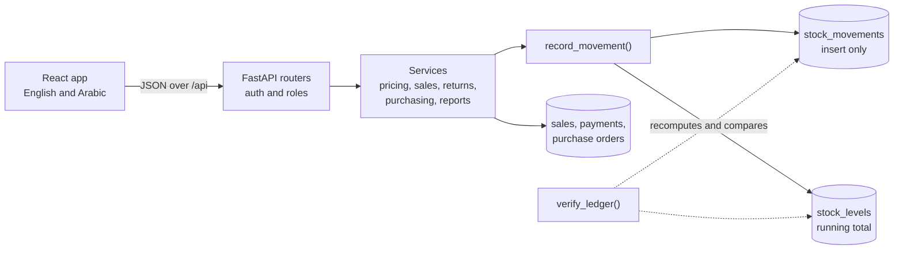

Sales, returns, deliveries and adjustments all go through `record_movement`, which adds a ledger row and updates the running total in the same transaction. On PostgreSQL the stock row is locked with `FOR UPDATE`, so two tills cannot sell the last unit twice. `verify_ledger` recomputes every balance from the ledger and reports any mismatch.

Amounts are stored as whole dirhams (1 QAR = 100 dirhams) and handled as `Decimal` in Python, so no floating point touches a price. An order discount is split across lines with the largest remainder method, so the shares always add up to the discount exactly. The browser runs the same rules for the live total, and the server recalculates everything at checkout.

A return pays back the line's share of what the customer actually paid. When the last unit of a line comes back, the refund is whatever is left of that line, so rounding can never leak a dirham. Only goods that go back on the shelf reduce the cost of goods sold.

The daily sales report is a cash view, where a refund counts on the day it was paid out. Product, category and cashier reports show what was really sold, so a sale stays on its own date with later returns netted off. Every sale also stores its local business date, so a sale at 1 am Doha time lands on the right day whatever the server's time zone.

`tests/test_stock_invariants.py` runs random mixes of purchases, sales, returns, adjustments and counts through the API, then checks the ledger, the running totals and the money on every sale.

| Path | What is there |
| --- | --- |
| `backend/app/routers` | HTTP endpoints, kept thin |
| `backend/app/services` | Business rules: pricing, inventory, sales, returns, purchasing, reports |
| `backend/app/models` | SQLAlchemy 2 models |
| `backend/app/schemas` | Pydantic v2 request and response shapes |
| `backend/alembic` | Database migrations |
| `backend/tests` | pytest suite, on an in-memory SQLite database |
| `backend/scripts` | The benchmark |
| `frontend/src/pages` | One file per screen |
| `frontend/src/i18n` | English and Arabic text |
| `frontend/src/lib/pricing.ts` | Live cart totals, matching the server's rules |

### API

Interactive docs are at http://127.0.0.1:8000/docs while the API is running. Use Authorize there with a demo login to try the protected endpoints. The backend runs on FastAPI 0.162 and the frontend on React 19.

| Area | Prefix | Who |
| --- | --- | --- |
| Login, current user, change password | `/api/auth` | Everyone |
| Sales, receipts | `/api/sales` | Everyone (cashiers see only their own sales) |
| Returns | `/api/sales/{id}/returns`, `/api/returns` | Owner, manager |
| Products, categories | `/api/products`, `/api/categories` | Read: everyone. Write: owner, manager |
| Stock levels | `/api/inventory/stock` | Everyone (cashiers see only their branch) |
| Ledger, adjustments, ledger check | `/api/inventory` | Owner, manager |
| Suppliers, purchase orders | `/api/suppliers`, `/api/purchase-orders` | Owner, manager |
| Reports, with `?format=csv` | `/api/reports` | Owner, manager |
| Branches, settings | `/api/branches`, `/api/settings` | Read: everyone. Write: owner |
| Staff accounts | `/api/users` | Read: owner, manager. Write: owner |

## Before using it in a real shop

The core flows are well tested, but Dukkan has not been used in a live shop. Add database backups, set your own secret key and put it behind HTTPS first. Login attempts are not rate limited yet, and changing a password does not sign out sessions that are already open.

The hardware side is untested. Barcode support is built for USB scanners that act as a keyboard, typing the code and pressing Enter, and has only been tried by typing codes in the browser. Receipts print through the browser's print dialog, with a layout sized for 80 mm paper, and there is a plain text receipt at `/api/sales/{id}/receipt`. Neither has been tried on a physical thermal printer.

It can run entirely on a shop computer or local network. The app's only outside request is for the web font, and it falls back to a system font without it. The developer docs page at `/docs` does load its files from a CDN. A till needs to reach the server to sell, so checkout stops while the server is down.

## Planned

- Stock transfers between branches
- Line discounts in the checkout screen (the API already has them)
- Reorder suggestions based on recent sales
- Expiry dates and batches for pharmacies and groceries
- Customer accounts and store credit
- Cash drawer sessions with end of day counts
- Items sold by weight
- Dark mode
- Offline checkout that syncs when the connection returns
- Login rate limiting and signing out of other devices

Bug reports and pull requests are welcome. [CONTRIBUTING.md](CONTRIBUTING.md) covers setup, code style, tests and the pull request checklist.

## License

[MIT](LICENSE). Copyright (c) 2026 Mohaned Elhagar.
