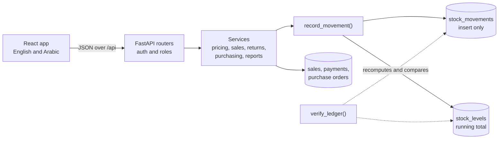

<p align="center">
  
</p>

**Dukkan is an open-source point of sale and inventory system for small shops in Qatar and the Gulf, such as groceries, pharmacies and phone shops, with a full Arabic interface and prices in QAR.**

[](LICENSE)


[](CONTRIBUTING.md)

## Start here

| If you... | Go to |
| --- | --- |
| Run a shop and want to try it | [Quick start](#quick-start) |
| Are a developer | [How it works](#how-it-works) and the [API overview](#api-overview) |
| Want to see it first | [Screenshots](#screenshots) |

## Why

Dukkan (دكان) is the Arabic word for a small shop.

Many small shops still keep stock in a notebook or a spreadsheet, or pay for point of sale software designed for much bigger chains. The owner finds out an item ran out when a customer asks for it, and the profit for the month is a guess.

Language matters here too. A shop in Doha often has an Arabic speaking owner, English speaking staff and customers who read either. Bolting a translation onto an English product is not enough: the layout has to mirror for right to left reading, and product names have to exist in both languages. In Dukkan each user picks a language, the whole interface flips to RTL, and every product, category and branch has an Arabic name.

The other idea behind the project is that stock numbers should be provable. Every change to stock is a row in a ledger, so the number on the screen can always be explained line by line.

## Results

Real measurements, not targets. Every line can be reproduced with the command next to it.

| Measure | Result | Reproduce with |
| --- | --- | --- |
| Backend tests | 149 passing | `pytest` |
| Line coverage of `backend/app` | 96% | `pytest --cov` |
| Barcode lookup, p50 / p95 | 3.6 to 4.6 ms / 7.0 to 10.5 ms | `python scripts/bench_checkout.py` |
| Checkout with 3 items, p50 / p95 | 13.8 to 18.5 ms / 24.6 to 35.9 ms | same |
| 30 day summary report, p50 / p95 | 18.3 to 30.0 ms / 27.2 to 40.8 ms | same |
| Seeding the 45 day demo shop (2,266 sales) | 11.4 to 16.5 s | same |
| Main JavaScript bundle | 414 kB, 124 kB gzipped | `npm run build` |
| Reports bundle, loaded only when opened | 379 kB, 111 kB gzipped | `npm run build` |
| API surface | 50 operations on 38 paths | `/openapi.json` |
| Interface text | 279 strings in both English and Arabic | `frontend/src/i18n` |

The latency figures are the range across three runs of the benchmark on one Windows 11 laptop with Python 3.12, using a SQLite file, one client and one uvicorn worker. They describe one till on the same machine as the server, so expect different numbers on your hardware.

PostgreSQL was checked by hand on version 16.2: migrations up and down, the seed command, every report, and 20 parallel checkouts of an item with 5 units left. Exactly 5 sales went through, the other 15 were refused, all receipt numbers were unique and the ledger stayed consistent. The automated test suite itself runs on SQLite.

## Screenshots

These are real captures of the running app with the demo shop loaded.

| | |
| --- | --- |
|  |  |
| **Checkout.** Scan, search or tap to build a sale. | **The same screen in Arabic**, mirrored right to left. |
|  |  |
| **Payment.** Split between cash, card and wallet, with change worked out. | **Receipt.** Shop details in both languages. |
|  |  |
| **Reports.** Sales, profit, payment mix and CSV export. | **Reports in Arabic.** |
|  |  |
| **Inventory.** Low stock at a glance, per branch. | **Stock ledger.** Every change, with who made it and the balance after. |
|  |  |
| **Purchasing.** Receive a delivery in full or in parts. | **Products.** Prices, margin and stock per branch. |

## Features

**Checkout**
- Keyboard and barcode friendly: F2 search, F4 pay, F8 clear, Enter to add a scanned code
- Order discounts by percent or amount, with a limit for cashiers set by the owner
- Split payments across cash, card and wallet, with change given from cash only
- Printable receipts in the browser, plus a plain text version for 80 mm printers
- Returns and refunds at the discounted price actually paid, with damaged goods kept out of stock

**Inventory**
- Stock per branch, low stock thresholds and an append-only movement ledger
- Stock adjustments with reasons: count, damaged, expired, lost, internal use
- A ledger check from the app or the command line that proves stock matches its history

**Purchasing**
- Suppliers, and purchase orders from draft to ordered to received
- Partial deliveries, with invoice prices that can differ from the order
- Moving average cost updated on every delivery
- One click to add low stock items to a new order

**Reports**
- Daily sales, top products, profit by category, slow movers, stock valuation, cashier performance
- CSV export of every table report, which opens in Excel with Arabic intact

**Shop setup**
- Owner, manager and cashier roles, with costs hidden from cashiers
- Multiple branches, and cashiers locked to their own branch
- No VAT by default, as in Qatar today, with a configurable shop rate and per product overrides
- English and Arabic with a language toggle and full RTL layout

## Quick start

You need [Python 3.12](https://www.python.org/downloads/), [Node.js 22 or newer](https://nodejs.org/) and Git. The commands below are for PowerShell on Windows. The [Windows run guide](docs/running-on-windows.md) has more detail and fixes for common problems.

**1. Start the API** in one terminal:

```powershell
git clone https://github.com/Ifazawezk/dukkan.git
cd dukkan\backend
python -m venv .venv
.venv\Scripts\Activate.ps1
pip install -r requirements-dev.txt
copy .env.example .env
alembic upgrade head
python -m app.cli seed
uvicorn app.main:app --reload
```

**2. Start the web app** in a second terminal:

```powershell
cd dukkan\frontend
npm install
npm run dev
```

**3. Open http://localhost:5173** and sign in. Every demo account uses the password `dukkan123`.

| Username | Role | Lands on |
| --- | --- | --- |
| `owner` | Owner, everything including settings and staff | Reports |
| `manager` | Manager, Al Sadd branch | Reports |
| `rahul`, `maria` | Cashiers, Al Sadd branch | Checkout |
| `omar` | Cashier, Al Wakra branch | Checkout |

### With Docker

```bash
docker compose up --build
docker compose exec api python -m app.cli seed
```

Then open http://localhost:8080. This runs the web app, the API and PostgreSQL. Set `POSTGRES_PASSWORD` and `DUKKAN_SECRET_KEY` before using it for anything real; see the notes at the top of [docker-compose.yml](docker-compose.yml).

The Docker files have not been run yet, because the machine this was built on has no Docker. The PostgreSQL setup they use was tested separately, as described under [Results](#results).

## How it works



**One door for stock.** Sales, returns, deliveries and adjustments all go through `record_movement`, which adds a ledger row and updates the running total in the same transaction. On PostgreSQL the stock row is locked with `FOR UPDATE`, so two tills cannot sell the last unit twice. `verify_ledger` recomputes every balance from the ledger and reports any mismatch.

**Exact money.** Amounts are stored as whole dirhams (1 QAR = 100 dirhams) and are `Decimal` in Python, so no floating point touches a price. An order discount is split across lines with the largest remainder method, so the shares always add up to the discount exactly. The browser runs the same rules for the live total, and the server recalculates everything at checkout.

**Refunds that add up.** A return pays back the line's share of what the customer actually paid. When the last unit of a line comes back, the refund is whatever is left of that line, so rounding can never leak a dirham. Only goods that return to the shelf reduce the cost of goods sold.

**Two views of returns.** The daily sales report is a cash view, where a refund counts on the day it was paid out. Product, category and cashier reports show what was really sold, so a sale stays on its own date with later returns netted off. Every sale also stores its local business date, so a sale at 1 am Doha time lands on the right day whatever the server's time zone.

The test suite backs this up. `tests/test_stock_invariants.py` runs random mixes of purchases, sales, returns, adjustments and counts through the API, then checks the ledger, the running totals and the money on every sale.

### Project layout

| Path | What is there |
| --- | --- |
| `backend/app/routers` | HTTP endpoints, kept thin |
| `backend/app/services` | Business rules: pricing, inventory, sales, returns, purchasing, reports |
| `backend/app/models` | SQLAlchemy 2 models |
| `backend/app/schemas` | Pydantic v2 request and response shapes |
| `backend/alembic` | Database migrations |
| `backend/tests` | pytest suite, on an in-memory SQLite database |
| `backend/scripts` | The benchmark |
| `frontend/src/pages` | One file per screen |
| `frontend/src/i18n` | English and Arabic text |
| `frontend/src/lib/pricing.ts` | Live cart totals, matching the server's rules |

### API overview

Interactive docs are at **http://127.0.0.1:8000/docs** while the API is running. Use **Authorize** there with a demo login to try the protected endpoints.

| Area | Prefix | Who |
| --- | --- | --- |
| Login, current user, change password | `/api/auth` | Everyone |
| Sales, receipts | `/api/sales` | Everyone (cashiers see only their own sales) |
| Returns | `/api/sales/{id}/returns`, `/api/returns` | Owner, manager |
| Products, categories | `/api/products`, `/api/categories` | Read: everyone. Write: owner, manager |
| Stock levels | `/api/inventory/stock` | Everyone (cashiers see only their branch) |
| Ledger, adjustments, ledger check | `/api/inventory` | Owner, manager |
| Suppliers, purchase orders | `/api/suppliers`, `/api/purchase-orders` | Owner, manager |
| Reports, with `?format=csv` | `/api/reports` | Owner, manager |
| Branches, settings | `/api/branches`, `/api/settings` | Read: everyone. Write: owner |
| Staff accounts | `/api/users` | Read: owner, manager. Write: owner |

## Roadmap

- [x] Roles, branches and JWT login
- [x] Products, categories and barcodes
- [x] Stock ledger with a consistency check
- [x] Suppliers and purchase orders with partial receiving
- [x] Checkout with discounts and split payments
- [x] Returns and refunds
- [x] Reports with CSV export
- [x] Arabic interface with RTL layout
- [ ] Stock transfers between branches
- [ ] Line discounts in the checkout screen (the API already has them)
- [ ] Reorder suggestions based on recent sales
- [ ] Expiry dates and batches for pharmacies and groceries
- [ ] Customer accounts and store credit
- [ ] Cash drawer sessions with end of day counts
- [ ] Items sold by weight
- [ ] Dark mode
- [ ] Offline checkout that syncs when the connection returns
- [ ] Login rate limiting and signing out of other devices

## FAQ

**Is it ready for a real shop?**
Not yet without some care. The core flows are well tested, but it has not been used in a live shop. Before real use, add database backups, set your own secret key and put it behind HTTPS. Login attempts are not rate limited yet, and changing a password does not sign out sessions that are already open.

**Does it charge VAT?**
Not by default, because Qatar has no VAT today. An owner can set a shop wide rate in Settings and override it per product. Tax is added on top of the price after discounts. Prices that already include tax are not supported yet.

**Does it work with a barcode scanner?**
It is built for USB scanners that act as a keyboard: they type the code and press Enter. That flow is tested by typing codes in the browser, not yet with physical hardware.

**Can it print receipts?**
Yes, through the browser's print dialog, with a layout sized for 80 mm paper. There is also a plain text receipt at `/api/sales/{id}/receipt`. Neither has been tried on a physical thermal printer yet.

**Does it need the internet?**
No. It can run entirely on a shop computer or local network. The app's only outside request is for the web font, and it falls back to a system font without one. The developer docs page at `/docs` does load its files from a CDN. Checkout needs to reach the server, so a till cannot sell while the server is down.

**What happens if stock runs out during a sale?**
The sale is refused with a clear message and nothing is saved. An owner who prefers to sell first and fix the count later can turn on negative stock in Settings.

**Why is the demo data different each day?**
The seed command builds its history backwards from today, so the reports always have recent data. The random seed is fixed, so two runs at the same moment give the same shop.

## Contributing

Bug reports and pull requests are welcome. [CONTRIBUTING.md](CONTRIBUTING.md) covers setup, code style, tests and the pull request checklist.

## License

[MIT](LICENSE). Copyright (c) 2026 Mohaned Elhagar.
